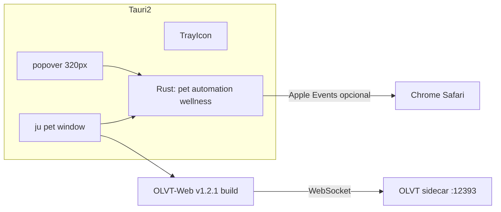

# Plano: PIVOT Ju (adaptar scaffold existente)

> **For agentic workers:** REQUIRED SUB-SKILL: Use superpowers:subagent-driven-development or superpowers:executing-plans. Steps use `- [ ]` checkboxes.

**Goal:** Aplicar [PIVOT.md](PIVOT.md) no repo já iniciado (popover, session machine, sidecar OLVT, telas) — **sem recomeçar do zero**.

**Fonte da verdade:** [PIVOT.md](PIVOT.md) substitui partes de [PLAN.md](PLAN.md) e trechos do [README.md](README.md). Manter [BRIEF.md](BRIEF.md) e `design/` intactos.

**O que já existe (reutilizar):**

- Popover + 8 telas: [`src/screens/*`](src/screens/), [`src/styles/*`](src/styles/), [`src/main.ts`](src/main.ts)
- Sessão + testes: [`src/session/machine.ts`](src/session/machine.ts) (14 testes passando)
- Shell Tauri: [`src-tauri/`](src-tauri/) (tray, sidecar, presence, logstore, `macOSPrivateApi: true`)
- OLVT pin: `vendor/Open-LLM-VTuber` @ `3afa41014b4548a0842e9ee2f576f4b164b48886`, [`overlay/olvt/`](overlay/olvt/), [`scripts/olvt.sh`](scripts/olvt.sh)
- Wireframes novos: [`design/personagem.html`](design/personagem.html), [`design/bemestar.html`](design/bemestar.html)

**Remover / refatorar (contradições ao pivot):**

- [`showAvatar`](src/session/machine.ts) / `summonAvatar` / tecla `V` — Ju fica **sempre** visível no pet
- Avatar flutuante em [`src/screens/mid.ts`](src/screens/mid.ts) — balão vai para janela Ju (+ popover mantém texto a11y)
- README: linhas “avatar só no check-in” e “sem Accessibility” → Automation para browser, sem Screen Recording

## Restrições globais (inalteradas + pivot)

- Pin OLVT **v1.2.1** SHA `3afa41014b4548a0842e9ee2f576f4b164b48886`; prompt de sistema **byte a byte** em [`overlay/olvt/apply_config.py`](overlay/olvt/apply_config.py)
- Edge TTS `pt-BR-FranciscaNeural`; system states **não bloqueiam** `Começar`
- 3 check-ins; pausa `Pausado. Sem pressa.`
- Título/URL de aba: **só memória local**, **nunca** LLM/nuvem, **nunca** persistidos; log só **minutos de distração/dia**
- Commits: `git -c user.name="Manoel Freitas" -c user.email="manoel.josefneto@gmail.com"`; push `origin main`
- Não tocar: tdah-body-double, DevSpace, foco-menu-bar

---

## Fase 1 — Janela pet Ju + visuais OLVT-Web

### 1.1 Config Tauri: segunda janela `ju`

**Arquivos:** [`src-tauri/tauri.conf.json`](src-tauri/tauri.conf.json), [`src-tauri/capabilities/default.json`](src-tauri/capabilities/default.json), novo [`src-tauri/capabilities/ju.json`](src-tauri/capabilities/ju.json)

- Adicionar janela `ju`: ~128×128 default (tamanho M), `transparent: true`, `decorations: false`, `alwaysOnTop: true`, `skipTaskbar: true`, `visible: true`, `focus: false` na criação
- Manter janela `popover` como hoje (320×420, sem roubar foco no check-in automático)
- Vite **multi-page**: [`vite.config.ts`](vite.config.ts) — entries `index.html` (popover) + `pet.html` (Ju)

### 1.2 Rust: módulo pet (`pet.rs`)

**Criar:** [`src-tauri/src/pet.rs`](src-tauri/src/pet.rs) — integrar em [`lib.rs`](src-tauri/src/lib.rs)

- Setup: posicionar canto inferior direito; persistir posição/tamanho em `~/Library/Application Support/com.manoelfreitas.junto/pet.json`
- **Click-through:** `set_ignore_cursor_events(true)` na janela; área “corpo” via hit-test no front (mensagem `ju-hit-region` com retângulo em % da janela) ou overlay Rust que alterna ignore só sobre o corpo Live2D (preferir solução que compile no Mac; stub no Linux)
- **Arrastar:** `@tauri-apps/api/window` `startDragging()` no mousedown no corpo
- **Não roubar foco:** `NSPanel`/`set_focus(false)` ao mostrar alertas; pet nunca `set_focus(true)` exceto se usuário abrir menu explícito
- **Visibilidade:** esconder Ju em fullscreen, reunião ([`presence.rs`](src-tauri/src/presence.rs)), macOS Focus (best-effort), screen sharing (heurística: app de reunião + flag futura); **fila de alertas** enquanto oculta
- **Atalho** `⌥⌘J`: `tauri-plugin-global-shortcut` — toggle visibilidade Ju
- **Tamanhos S/M/L:** 96 / 128 / 160 px — itens no menu da tray + comando `ju_set_size`
- Estados Ju mapeados de sessão + motor: `idle` | `working` | `calling` | `pause` | `done` | `needs-adjustment` (ver [`design/personagem.html`](design/personagem.html))

### 1.3 Frontend pet + OLVT-Web v1.2.1

**Criar:** [`pet.html`](pet.html), [`src/pet/main.ts`](src/pet/main.ts), [`src/pet/shell.css`](src/pet/shell.css), [`src/ju/state.ts`](src/ju/state.ts), [`src/ju/balloon.ts`](src/ju/balloon.ts), [`src/ju/alerts.ts`](src/ju/alerts.ts)

- **Script:** [`scripts/build-ju-web.sh`](scripts/build-ju-web.sh) — `git submodule update --init` de `vendor/Open-LLM-VTuber/frontend` (repo [Open-LLM-VTuber-Web](https://github.com/Open-LLM-VTuber/Open-LLM-VTuber-Web)), checkout **tag v1.2.1**, `npm ci` + `npm run build:web` (validar script no `package.json` do submodule); artefatos para `vendor/Open-LLM-VTuber/frontend/` ou cópia para `public/ju-web/`
- Pet carrega **WebView** apontando para `http://127.0.0.1:12393/` (servido pelo sidecar) com shell transparente **ou** assets estáticos built + WebSocket ao OLVT — **sem Electron**
- Balão HTML/CSS sobre o canvas Live2D (tokens de [`src/styles/tokens.css`](src/styles/tokens.css)): check-in, pausa, distração, bem-estar; `aria-live` para VoiceOver
- **Escada de alerta:** (1) aceno + balão; (2) após 20s `calling` + animação pulo (respeitar `prefers-reduced-motion`); (3) som opcional do usuário. **Máx 1 alerta / 10 min** ([`src/ju/alerts.ts`](src/ju/alerts.ts))
- Sincronização: `main.ts` popover emite `ju-state` / escuta `ju-action`; [`src/main.ts`](src/main.ts) passa `juState` no `junto_sync` em vez de `showAvatar`

### 1.4 Testes (Vitest)

- [`src/ju/state.test.ts`](src/ju/state.test.ts): mapeamento fase sessão → estado Ju
- [`src/ju/alerts.test.ts`](src/ju/alerts.test.ts): cooldown 10 min, níveis 1–3
- Ajustar [`machine.test.ts`](src/session/machine.test.ts) se remover `summonAvatar`

---

## Fase 2 — Sensor de distração (Automation, OFF por padrão)

### 2.1 Rust: `automation.rs`

**Criar:** [`src-tauri/src/automation.rs`](src-tauri/src/automation.rs), [`config/distraction-categories.json`](config/distraction-categories.json)

- Preferência `distraction_enabled: false` em `pet.json` ou `settings.json`
- Poll ~15s **somente se** usuário ligou no popover
- AppleScript / `osascript` para **Chrome** e **Safari**: URL da aba ativa → extrair **domínio** → descartar título/URL imediatamente
- Match categorias editáveis (short video primeiro: youtube.com/shorts, reels, tiktok.com; depois social, streaming, games, betting, shopping, news) — alinhado a [`design/bemestar.html`](design/bemestar.html)
- **~3 min** contínuos em domínio de distração → evento `distraction-detected` → Ju `calling` + pergunta **"Ainda em {meta}?"** (nunca nome do site); respostas: voltando / **"É pausa"** → `pauseSession` sem bronca
- **Deny (-1743):** aviso **uma vez** por browser + botão Abrir Ajustes; feature desliga só para aquele browser; resto do app ok
- **[`Info.plist`](src-tauri/Info.plist):** `NSAppleEventsUsageDescription` — texto pt-BR claro (Automação para ler site da aba ativa; sem captura de tela)

### 2.2 Popover: UI distração

**Criar:** [`src/screens/distraction.ts`](src/screens/distraction.ts), [`src/screens/distraction-categories.ts`](src/screens/distraction-categories.ts)

- Toggle “Perceber distrações” (default **off**); não na primeira abertura
- Fluxo permissão + lista de categorias (chips editáveis)
- Integrar strip em [`main.ts`](src/main.ts) sem bloquear `Começar`

### 2.3 Log de privacidade

**Estender:** [`src-tauri/src/logstore.rs`](src-tauri/src/logstore.rs) — `distraction_log.json` com **só** `{ date, total_ms }` agregado; **não** estender `SessionRecord` com URL/título

### 2.4 Testes

- [`src/automation/domains.test.ts`](src/automation/domains.test.ts): classificação domínio → categoria (puramente TS, espelha regras do JSON)

---

## Fase 3 — Lembretes de bem-estar (bordas da sessão)

**Criar:** [`src/wellness/toggles.ts`](src/wellness/toggles.ts), [`src/wellness/scheduler.ts`](src/wellness/scheduler.ts), [`src/screens/wellness.ts`](src/screens/wellness.ts), [`src/wellness/wellness.test.ts`](src/wellness/wellness.test.ts)

- Toggles independentes (default sensato: respiração **off**, água **on**, alongar **on**, pausa longa **on**) em settings locais
- **Respiração 1 min:** opcional **antes** de `submitGoal` → fase `pre_breath` (corpo Ju anima 4s/6s; reduced motion = só texto)
- **Água:** após fluxo `end` / `Saiu?` — balão Ju “Bloco feito. Um gole d'água?” — some em 15s
- **Alongar:** a cada **2** blocos concluídos (`blocks_completed` no state)
- **Pausa longa:** após **4** blocos — sugere pausa sem streak
- Cada lembrete conta no limite **1 alerta / 10 min**; nunca no meio do timer de foco
- Respeitar reunião/Focus (mesma fila do pet)

**Estender** [`SessionState`](src/session/machine.ts): `blocksCompleted`, `wellness`, `preBreathPending`; manter compatibilidade dos testes existentes.

---

## Fase 4 — Integração, docs, scripts, git

### 4.1 [`scripts/dev.sh`](scripts/dev.sh)

- Submodule OLVT + SHA pin
- Opcional: `scripts/build-ju-web.sh` se `frontend/` vazio
- Linux: `npm test`; Darwin: `npm run tauri dev`

### 4.2 README pt-BR

Reescrever seções em [`README.md`](README.md):

- Arquitetura **dupla janela** (popover + pet Ju no Tauri, não Electron)
- OLVT-Web v1.2.1 `build:web` + sidecar
- Automation: quando pede, o que lê, o que **não** persiste
- Bem-estar: toggles, bordas, sem promessa de produtividade
- Permissões: Automação (opcional), Microfone (opcional), **sem** Screen Recording
- Comandos Mac, limitações (Meet no browser, Focus best-effort)
- Nota rename-if-published (manter)

### 4.3 Dependências npm/rust

- `@tauri-apps/plugin-global-shortcut` + registro em `Cargo.toml` / `lib.rs`
- Atualizar [`package.json`](package.json) se necessário

### 4.4 Verificação e push

- [ ] `npm test` verde (Linux)
- [ ] `git -C vendor/Open-LLM-VTuber status` limpo (gitlink só)
- [ ] Commits sugeridos (3):
  1. `feat: pet Ju sempre visível com OLVT-Web v1.2.1`
  2. `feat: distração opcional via Automation e bem-estar`
  3. `docs: README pivot Ju, privacidade e dev.sh`
- [ ] `git push -u origin main`

---

## Auto-revisão (PIVOT.md)

| Requisito pivot | Tarefa |
|-----------------|--------|
| Ju sempre visível, pet Tauri | Fase 1 |
| OLVT-Web build:web, não Electron | 1.3 + build-ju-web.sh |
| 6 estados + escada + ⌥⌘J + S/M/L + esconder | 1.2–1.3 |
| Automation OFF, domínios, 3 min, sem LLM/log URL | Fase 2 |
| Bem-estar bordas + toggles | Fase 3 |
| 8 telas popover + tokens + a11y | manter + novas telas settings |
| README + plist NSAppleEvents | Fase 4 |
| OLVT pin + prompt | manter overlay |

**Risco Mac-only:** click-through por região e Apple Events só validam em `tauri dev` no Mac; Linux continua com `npm test` + stubs `#[cfg(not(target_os = "macos"))]`.