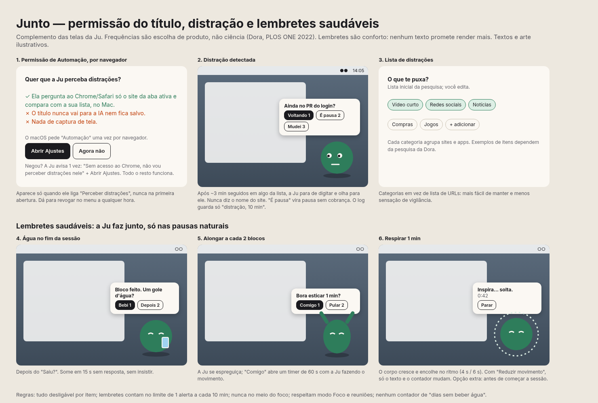

# Lembretes saudáveis

Toggles em **⌥B** no popover.

| Opção | Padrão |
|-------|--------|
| Respiração 1 min antes de começar | off |
| Água ao fim do bloco | on |
| Alongar a cada 2 blocos | on |
| Pausa longa a cada 4 blocos | on |

Lembretes contam no limite de um alerta a cada 10 minutos. Sem streak e sem cobrança.