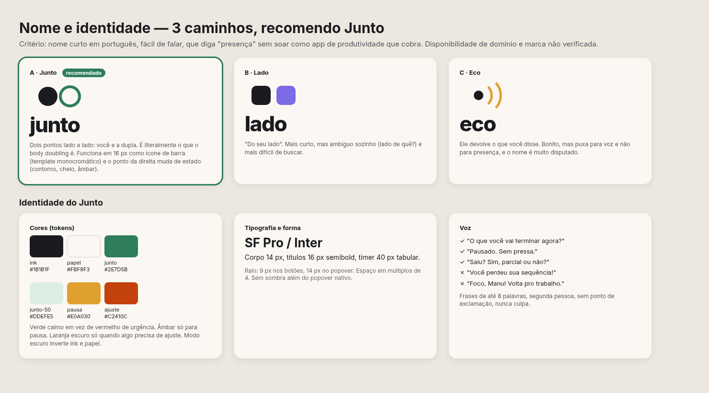

# Junto

Companion de foco para macOS: ícone na barra de menu, popover de 320 px e **Ju**, pet no canto da tela.

O app abre sem janela no Dock. Você define uma meta, trabalha em blocos e responde a três check-ins por sessão. A Ju fica no canto, em silêncio, e só chama quando o fluxo pede.

Repositório: [github.com/manoel-freitas/junto-macos](https://github.com/manoel-freitas/junto-macos)

## O que existe hoje

- Sessões com meta, duração 25 / 50 / livre, pausa e encerramento gentil
- Ju com Live2D (Open-LLM-VTuber v1.2.1) e balões HTML
- Convites proativos no horário de trabalho
- Autostart no login (LaunchAgent)
- Distração opcional por Automação do macOS
- Lembretes de bem-estar nas bordas da sessão

## Em breve

- [Brown noise integrado à sessão](https://github.com/manoel-freitas/junto-macos/issues/1)
- [Calendário Google e Apple (somente leitura)](https://github.com/manoel-freitas/junto-macos/issues/2)
- [Todoist: meta e conclusão com confirmação](https://github.com/manoel-freitas/junto-macos/issues/3)
- [Spotify como alternativa ao brown noise](https://github.com/manoel-freitas/junto-macos/issues/4)

Veja [Convites e horário](convites.md) para o que já está implementado.