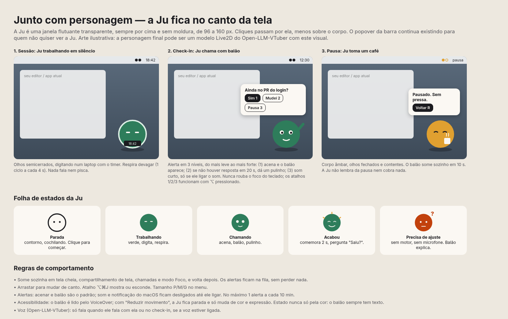

# A Ju

Ju é a janela transparente always-on-top com o avatar Live2D e balões HTML.

## Estados

`idle`, `working`, `calling`, `pause`, `done`, `needs-adjustment`.

## Alertas durante sessão

Escada: balão → após 20 s animação → som só se você ativar. Máximo um alerta a cada 10 minutos.

## Visibilidade

- **⌥⌘J** mostra ou oculta a Ju.
- Tamanhos P / M / G no menu da barra.
- Ju some em reunião, tela cheia e enquanto o silêncio manual de 1 h estiver ativo.

Arraste pelo corpo do personagem para mover. O resto da janela deixa cliques passarem.