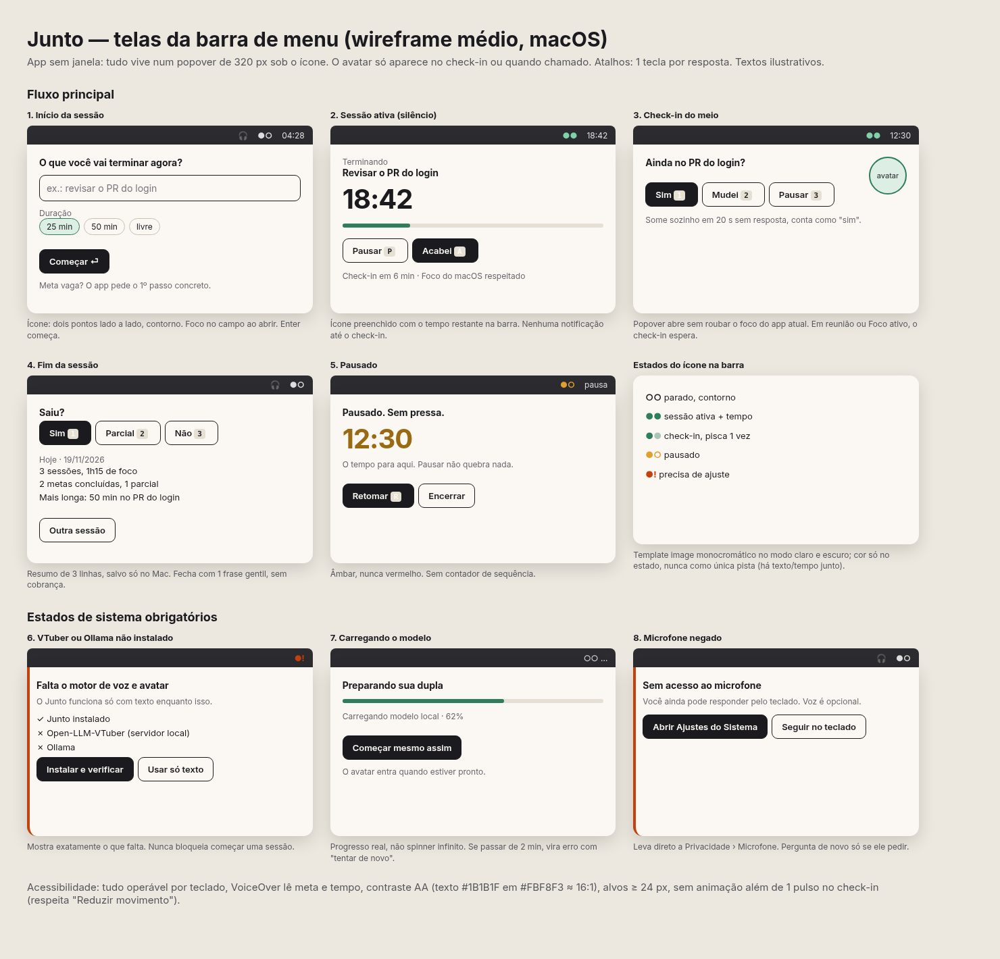

# Primeira sessão

1. Clique no ícone **Junto** na barra de menu.
2. Escreva o que vai terminar agora. Metas vagas pedem um primeiro passo concreto.
3. Escolha 25 min, 50 min ou livre.
4. Opcional: respiração de 1 min (se ligada em bem-estar).
5. Durante o bloco, use **P** para pausar e **A** para encerrar.
6. No meio, a Ju pergunta se você ainda está na meta.
7. No fim, responda se saiu: sim, parcial ou não.

Se o motor de voz ou o microfone não estiver pronto, o texto/teclado continua disponível. Nada bloqueia começar.